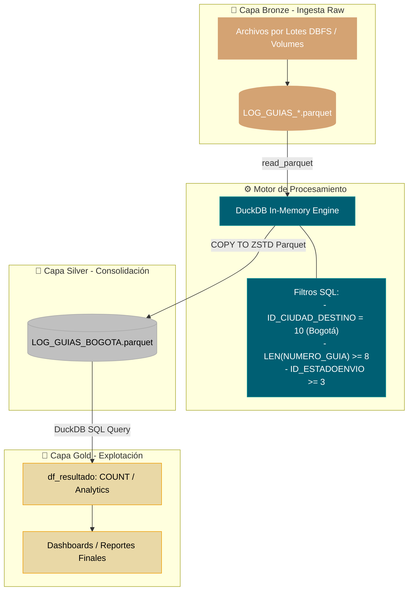

# 📊 UNIVERSIDAD SANTO TOMAS
* Facultad de Estadıstica
* Maestrıa en Ciencia de Datos
* Trabajo de grado
### MODELO DE APRENDIZAJE AUTOMATICO
#### PARA LA PREDICCION DE TIEMPOS DE ENTREGA Y LA ANTICIPACION DE INCUMPLIMIENTOS DE SLA EN LA LOGISTICA DE ULTIMA MILLA DE SERVIENVIOS (BOGOTA)

## Presentado por
------------
* `John Fernando Cruz Becerra`
* `Oscar Javier Huertas Campo`
* `Mauricio Alejandro Gaviria Alzate`

------------
## 📌 Introducción

Este proyecto define e implementa una canalización de datos (**ETL/ELT**) de alto rendimiento diseñada para la ingesta, limpieza, filtrado y consolidación masiva de registros de seguimiento logístico de guías de transporte.

Aprovechando el entorno de **Databricks Cloud** junto con la velocidad de ejecución in-memory de **DuckDB**, el pipeline procesa millones de registros almacenados en formato colummar comprimido (**Parquet con ZSTD**), garantizando un consumo mínimo de I/O y una aceleración óptima en las consultas.

---

## 🏗️ Mapeo a la Arquitectura Medallion

La arquitectura Medallion organiza los datos en capas lógicas para garantizar calidad, trazabilidad y rendimiento. A continuación se muestra cómo se traducen las etapas de este proyecto dentro de dicha arquitectura:

```
+-----------------------------------------------------------------------------------+
|                                 DATABRICKS CLOUD                                  |
|                                                                                   |
|  +-------------------+      +-------------------+      +-----------------------+  |
|  |   BRONZE LAYER    |  ==> |   SILVER LAYER    |  ==> |      GOLD LAYER       |  |
|  |  (Raw / Batches)  |      | (Clean & Filter)  |      | (Aggregated Analytics)|  |
|  +-------------------+      +-------------------+      +-----------------------+  |
|    Parquet Batch Logs          DuckDB Filtering           Consolidated Parquet    |
|    Multi-region / Files        & Column Normalization     Analytics Ready (ZSTD)  |
+-----------------------------------------------------------------------------------+
```

### 🥉 1. Capa Bronze (Raw / Ingesta)
* **Descripción:** Datos crudos ingeridos desde múltiples orígenes o archivos por lotes sin modificar.
* **Ubicación en el Proyecto:** `/Volumes/proyectogrado/source/sourcedb/LOG_GUIAS/LOG_GUIAS*.parquet`
* **Características:**
  * Almacena el histórico completo por lotes.
  * Contiene registros globales sin filtrar (todas las ciudades, estados de envío incompletos o en borrador, metadatos extendidos).

### 🥈 2. Capa Silver (Cleaned & Transformed / Normalización)
* **Descripción:** Datos filtrados, saneados, estandarizados y estructurados. Se eliminan registros irrelevantes o erróneos y se seleccionan las columnas clave de negocio.
* **Ubicación en el Proyecto:** `/Volumes/proyectogrado/source/sourcedb/LOG_GUIAS/RAW/LOG_GUIAS_BOGOTA.parquet`
* **Reglas de Negocio aplicadas vía DuckDB (`COPY ... FROM read_parquet`):**
  * **Filtrado Geográfico:** Restricción a destino específico (`ID_CIUDAD_DESTINO = 10` - Bogotá).
  * **Integridad de Guías:** Unicidad y formato (`LENGTH(NUMERO_GUIA::VARCHAR) >= 8`).
  * **Filtrado Operativo:** Guías activas/avanzadas (`ID_ESTADOENVIO >= 3`).
  * **Normalización de Esquema:** Casteo explícito a variables tipo `NULL AS NOMBRE_REMITE_GUIA`, `NULL AS TELEFONO_*`, etc.
  * **Compresión Optimizada:** Guardado final en formato Parquet con compresión **ZSTD**.

### 🥇 3. Capa Gold (Business Ready / Métricas y Reportes)
* **Descripción:** Capa orientada a negocio y consultas analíticas de alta velocidad (Data Marts, Tableros de PowerBI / Databricks SQL).
* **Ubicación en el Proyecto:** Consultas SQL consolidadas y DataFrames finales de resultado (`df_resultado`).
* **Métricas Principales:**
  * Conteo total de registros consolidados (`SELECT COUNT(1) AS TOTAL_REGISTROS`).
  * Análisis de volumen, tiempos de entrega y distribución por tipo de carga / transportador.

---

## 🔄 Diagrama de Flujo de Datos (Pipeline de Ejecución)

El flujo de procesamiento sigue una secuencia optimizada ejecutada dentro de un Notebook de Databricks:



---

## 🛠️ Tecnologías y Herramientas

| Componente | Tecnología | Rol en la Arquitectura |
| :--- | :--- | :--- |
| **Plataforma Cloud** | Databricks / DBFS Volumes | Orquestación, almacenamiento masivo y ejecución distribuida. |
| **Engine de Consultas** | DuckDB (`duckdb.connect()`) | Transformación rápida en memoria de archivos Parquet pesados. |
| **Lenguaje de Programación** | Python 3 / PySpark / Pandas | Scripting de automatización y manipulación de dataframes. |
| **Formato de Salida** | Apache Parquet (ZSTD) | Almacenamiento colummar eficiente y de alta compresión. |

---

## 📋 Resumen de Estructura de Datos (Esquema de Salida)

Las tablas procesadas en la Capa Silver / Gold consolidan más de **50 campos operativos y financieros**, entre los que destacan:

* **Identificadores Logísticos:** `NUMERO_GUIA`, `ID_TIPOGUIA`, `ID_CLIENTE`, `ID_CANAL`, `ID_CARACT_ENVIO`.
* **Geolocalización:** `ID_PAIS_ORIGEN`, `ID_CIUDAD_ORIGEN`, `ID_PAIS_DESTINO`, `ID_CIUDAD_DESTINO`, `ID_ZONA_URBA`.
* **Métricas Pesos y Medidas:** `PESO_GUIA`, `PESO_FISICO_GUIA`, `PESO_VOLU_GUIA`, `LARGO_ENVIO`, `ALTO_ENVIO`, `ANCHO_ENVIO`.
* **Financiero & Facturación:** `VALOR_DECLARADO_GUIA`, `VALOR_FLETES_GUIAS`, `VALOR_DESCUENTO_GUIAS`, `ID_FACTURADO`.
* **Fechas de Trazabilidad:** `FECHA_ENVIO`, `FECHA_ENTREGA`, `FECHA_CREACION`, `FECHA_MODIFICACION`.


